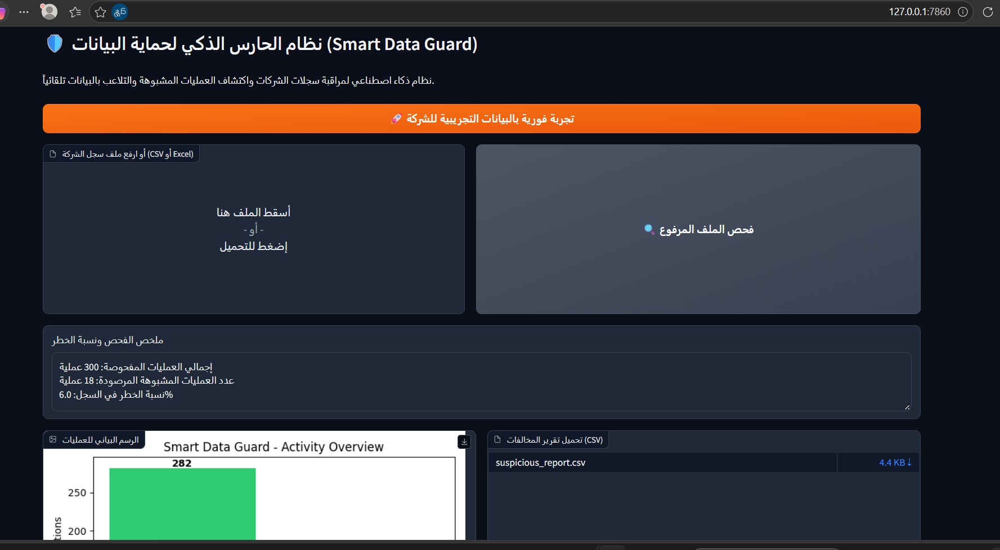
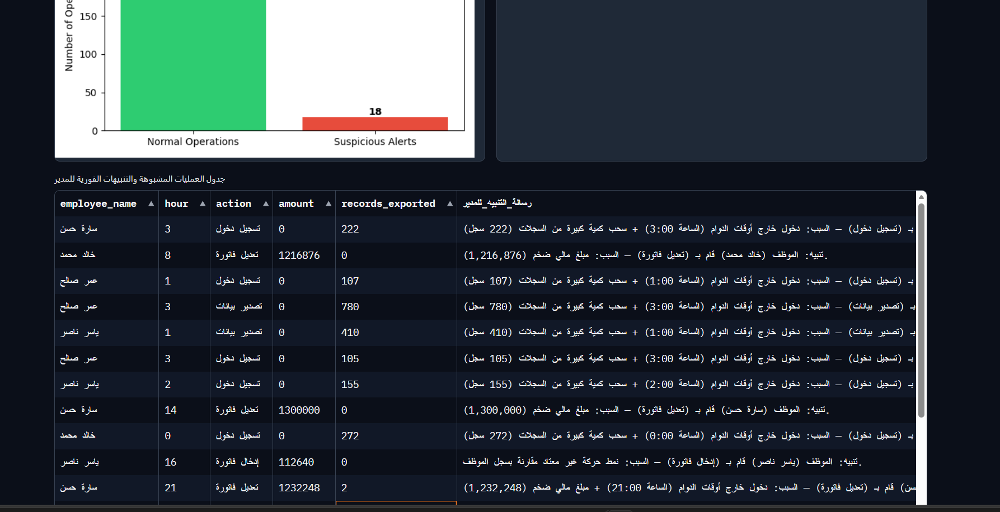

# 🛡️ Smart Data Guard | نظام الحارس الذكي لحماية البيانات

An AI-powered anomaly detection system built with Python, Scikit-Learn, Pandas, and Gradio to monitor company operation logs, detect suspicious employee activities, and generate instant management alerts.

نظام ذكاء اصطناعي لمراقبة سجلات عمليات الشركات، واكتشاف الأنشطة المشبوهة والتلاعب المالي أو تسريب البيانات تلقائياً، مع صياغة تنبيهات إدارية فورية وتقارير قابلة للتصدير.

---

## 📸 لقطات من النظام (Screenshots)

### واجهة النظام وملخص الفحص


### الرسم البياني وجدول التنبيهات الإدارية


---

## ✨ المميزات الرئيسية (Key Features)

- **اكتشاف الشذوذ بالذكاء الاصطناعي:** استخدام خوارزمية `Isolation Forest` لرصد العمليات غير المعتادة تلقائياً (مثل الدخول خارج أوقات الدوام، تعديل مبالغ ضخمة، أو سحب سجلات عملاء بكميات كبيرة).
- **تنبيهات إدارية ذكية بالعربي:** ترجمة النتائج الرقمية إلى رسائل واضحة تشرح للمدير سبب الاشتباه والموظف المسؤول فوراً.
- **لوحة تحكم تفاعلية (Gradio UI):** تدعم الفحص الفوري للبيانات التجريبية أو رفع ملفات `CSV` و `Excel` الخاصة بأي شركة، مع رسم بياني وتصدير تقرير المخالفات.

---

## 🛠️ التقنيات المستخدمة (Tech Stack)

- **Language:** Python
- **Machine Learning:** Scikit-Learn (`IsolationForest`)
- **Data Processing:** Pandas, OpenPyXL
- **Visualization & UI:** Matplotlib, Gradio

---

## 🚀 طريقة التشغيل (How to Run)

```bash
git clone https://github.com/hamed77alotheeb/Smart-Data-Guard.git
cd Smart-Data-Guard
pip install -r requirements.txt
python app.py
```

---

## 👨‍💻 فريق التطوير (Contributors)

- **حميد العذيب (Hamed Al-Otheeb):** Data Simulation & AI Anomaly Detection Engine (`guard_engine.py`, `generate_data.py`).
- **سامي العقيلي (Sami Al-Aqelee):** Interactive Web Interface & Integration (`app.py`, `requirements.txt`).
